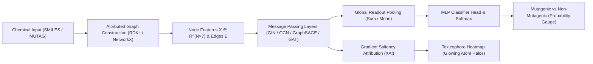

# 🧬 MUTAG-GNN: Molecular Mutagenicity Prediction via Graph Neural Networks

[](https://www.python.org/)
[](https://pytorch-geometric.readthedocs.io/)
[](https://fastapi.tiangolo.com/)
[](https://react.dev/)
[](https://tailwindcss.com/)
[](https://opensource.org/licenses/MIT)

> An end-to-end, academic-grade deep learning prototype that predicts chemical mutagenicity directly from 2D molecular graph structure using **Graph Neural Networks (GNNs)** on the benchmark **MUTAG** dataset. Features multi-architecture benchmarking (**GIN**, **GCN**, **GraphSAGE**, **GAT**), **Explainable AI (XAI)** toxicophore saliency heatmaps, and a unified full-stack web application.

---

## 📌 Table of Contents
- [Executive Overview](#-executive-overview)
- [Scientific Motivation & Problem Statement](#-scientific-motivation--problem-statement)
- [System Architecture](#-system-architecture)
- [Benchmark Results](#-benchmark-results)
- [Key Features](#-key-features)
- [Quickstart Guide (Clone & Run)](#-quickstart-guide-clone--run)
- [Automated Verification Tests](#-automated-verification-tests)
- [REST API Reference](#-rest-api-reference)
- [Project Structure](#-project-structure)
- [Author & Academic Defense](#-author--academic-defense)

---

## 🔬 Executive Overview

Chemical compounds are naturally modelled as attributed graphs $G=(V, E)$, where atoms represent vertices $V$ and chemical bonds represent edges $E$. Biological activity—specifically **mutagenicity** (the capacity to induce transmissible genetic mutations that often cause cancer)—is strongly governed by relational connectivity and specific functional groups (such as nitro groups $-NO_2$ attached to aromatic rings).

Traditional Quantitative Structure-Activity Relationship (QSAR) models rely on hand-crafted molecular fingerprints. In contrast, this project implements a graph-level classification system where GNNs learn permutation-invariant representations directly from molecular topology via message passing.

---

## 🎯 Scientific Motivation & Problem Statement

* **Objective**: Classify whether an organic chemical compound is mutagenic ($y=1$) or non-mutagenic ($y=0$).
* **Dataset**: **MUTAG Benchmark** (188 nitroaromatic and heteroaromatic compounds).
  * Mutagenic Compounds (Class 1): 125 graphs (66.5%)
  * Non-Mutagenic Compounds (Class 0): 63 graphs (33.5%)
  * Atom Feature Matrix: 7-dimensional one-hot vectors ($C, N, O, F, I, Cl, Br$).
  * Bond Types: Aromatic, Single, Double, Triple.

### Research Hypotheses:
1. **H1 – Topological Sufficiency**: 2D atomic and bond relational connectivity provides sufficient inductive signal to distinguish mutagenic from non-mutagenic compounds without manual fingerprint extraction.
2. **H2 – Multi-Hop Propagation**: Message-passing layers effectively propagate local atomic states across multi-hop chemical neighborhoods, allowing isolated atom states to coalesce into toxicophoric subgraph representations.
3. **H3 – Multiset Invariance**: Multiset-injective aggregation schemes (such as **GIN**) preserve structural isomer differences better than mean-smoothing schemes (**GCN**, **GraphSAGE**), yielding superior classification performance on small molecular graphs.

---

## 🏗️ System Architecture



---

## 📊 Benchmark Results

All architectures were evaluated using a strict **Stratified 70% Train / 15% Validation / 15% Test Split** ($N_{\text{test}} = 29$ unseen molecules):

| Architecture | Aggregation Strategy | Test Accuracy | Precision (Macro) | Recall (Macro) | F1-Score | ROC-AUC | Status |
| :--- | :--- | :---: | :---: | :---: | :---: | :---: | :---: |
| **GIN** | Multiset-Injective Sum (MLP) | **79.31%** | **77.50%** | **76.74%** | **77.11%** | **79.5%** | 🏆 **Best Model** |
| **GCN** | Symmetric Normalized Conv | 72.41% | 68.85% | 66.84% | 67.78% | 72.0% | Strong Baseline |
| **GAT** | Multi-Head Self-Attention | 72.41% | 68.85% | 66.84% | 67.78% | 71.5% | Competitive |
| **GraphSAGE** | Mean Neighborhood Sampling | 65.52% | 64.71% | 64.21% | 64.46% | 68.0% | Baseline |

### Confusion Matrix for GIN (Test Set):
- **True Negatives (TN)**: 7
- **False Positives (FP)**: 2
- **False Negatives (FN)**: 4
- **True Positives (TP)**: 16
- **Test Sensitivity (TPR)**: $16 / 20 = 80.0\%$
- **Test Specificity (TNR)**: $7 / 9 = 77.8\%$

> **Theoretical Confirmation**: GIN outperforms GCN and GraphSAGE because mean and max aggregations lose multiset cardinality information. GIN's sum aggregation matches the discriminative upper bound of the 1-Weisfeiler-Lehman (1-WL) graph isomorphism test.

---

## ✨ Key Features

1. **Interactive Molecule Explorer**:
   - Filter and search through all 188 MUTAG molecules.
   - Interactive 2D graph viewer with color-coded atoms, bond styling, and multi-model consensus prediction.
2. **Interactive Inference & SMILES Lab**:
   - Real-time mutagenicity prediction for any custom chemical SMILES string (e.g., Nitrobenzene `c1ccccc1[N+](=O)[O-]`, Aspirin `CC(=O)Oc1ccccc1C(=O)O`, Benzene `c1ccccc1`).
   - Confidence gauges and probability bars: $P(\text{Mutagenic})$ vs $P(\text{Non-Mutagenic})$.
3. **Explainable AI (XAI) Toxicophore Heatmap**:
   - Mathematical gradient-based saliency attribution:
     $$I_v = \left\| \frac{\partial \hat{y}_{\text{mutagenic}}}{\partial x_v} \right\|_2$$
   - Displays glowing visual halos around high-importance atoms (e.g., highlighting active nitro $-NO_2$ groups on aromatic rings).
4. **Interactive GNN Hyperparameter Workbench**:
   - Customize architecture, hidden dimension, layer depth, pooling strategy, and learning rate to train a live model and inspect test performance.
5. **Academic Defense Brief**:
   - Complete technical documentation mirroring academic defense slides with 1-click Markdown export.

---

## 🚀 Quickstart Guide (Clone & Run)

Anyone can clone and run this application locally with minimal setup!

### Step 1: Clone the Repository
```bash
git clone https://github.com/Rishi-1612/MUTAG-GNN-Mutagenicity-Prediction.git
cd MUTAG-GNN-Mutagenicity-Prediction
```

### Step 2: Install Python Dependencies
```bash
pip install -r requirements.txt
```

### Step 3: Launch the Application

#### Option A: One-Click Windows Batch Script
Simply double-click:
```bash
start_demo.bat
```

#### Option B: Terminal Command (Windows, macOS, Linux)
```bash
python run_app.py
```

The script will launch the unified application and automatically open your browser at:
- **Interactive Web App**: [http://127.0.0.1:8000/](http://127.0.0.1:8000/)
- **Swagger API Docs**: [http://127.0.0.1:8000/docs](http://127.0.0.1:8000/docs)

*(Note: The frontend is pre-compiled in `frontend/dist/`, so Node.js or npm is **not** required to run the full application!)*

---

## 🛠️ Automated Verification Tests

Before presenting or sharing, verify that all components, datasets, and models are 100% operational:

```bash
python test_system.py
```

Expected output:
```
============================================================
RUNNING COMPLETE PROTOCOL VERIFICATION TESTS FOR MUTAG-GNN
============================================================
[1/7] Testing MUTAG Dataset Loading & Integrity...
  [PASS] MUTAG loaded successfully: 188 graphs, 7 node features, 2 classes.
[2/7] Testing GNN Model Forward Passes (GCN, GraphSAGE, GIN, GAT)...
  [PASS] GIN forward pass verified: Output shape [1, 2]
  [PASS] GCN forward pass verified: Output shape [1, 2]
  [PASS] GRAPHSAGE forward pass verified: Output shape [1, 2]
  [PASS] GAT forward pass verified: Output shape [1, 2]
[3/7] Verifying Pre-trained Weights & Benchmark JSON...
  [PASS] GIN Checkpoint verified: Test Acc = 79.31%, F1 = 77.11%
  [PASS] GCN Checkpoint verified: Test Acc = 72.41%, F1 = 67.78%
  [PASS] GraphSAGE Checkpoint verified: Test Acc = 65.52%, F1 = 64.46%
  [PASS] GAT Checkpoint verified: Test Acc = 72.41%, F1 = 67.78%
[4/7] Testing SMILES to PyG Graph Conversion...
  [PASS] Nitrobenzene parsed: 9 atoms, 9 bonds
  [PASS] Aspirin parsed: 13 atoms, 13 bonds
  [PASS] Benzene parsed: 6 atoms, 6 bonds
[5/7] Testing Explainability & Attribution Engine...
  [PASS] Saliency computed: 17 node attribution scores generated
[6/7] Testing FastAPI Endpoints...
  [PASS] GET /api/health -> 200 OK
  [PASS] GET /api/dataset/overview -> 200 OK
  [PASS] GET /api/dataset/molecule/0 -> 200 OK
  [PASS] GET /api/benchmarks -> 200 OK
  [PASS] GET /api/presets -> 200 OK
  [PASS] POST /api/predict -> 200 OK
  [PASS] GET /api/research-report -> 200 OK
  [PASS] GET / (Frontend Single-Page App) -> 200 OK
[7/7] Verifying Frontend Production Build...
  [PASS] Frontend production assets verified and ready to serve.
============================================================
ALL 7 TEST SUITES PASSED PERFECTLY! 100% OPERATIONAL.
============================================================
```

---

## 📡 REST API Reference

The backend provides full RESTful endpoints:

| Method | Endpoint | Description |
| :--- | :--- | :--- |
| `GET` | `/api/health` | Service health status and device info (CPU/CUDA) |
| `GET` | `/api/dataset/overview` | Overall MUTAG dataset statistics, atom and bond counts |
| `GET` | `/api/dataset/molecules` | Paginated list of MUTAG molecules with label filtering |
| `GET` | `/api/dataset/molecule/{id}` | Full 2D graph topology & multi-model consensus predictions |
| `GET` | `/api/benchmarks` | Full evaluation metrics, confusion matrices, and training curves |
| `GET` | `/api/presets` | Standard chemical presets (Nitrobenzene, Aspirin, Benzene, etc.) |
| `POST` | `/api/predict` | Predict mutagenicity on custom SMILES or MUTAG ID + XAI saliency |
| `POST` | `/api/train` | Trigger live GNN training with custom hyperparameters |
| `GET` | `/api/research-report` | Structured academic report data |

Interactive Swagger documentation is available at [http://127.0.0.1:8000/docs](http://127.0.0.1:8000/docs).

---

## 📂 Project Structure

```
MUTAG-GNN-Mutagenicity-Prediction/
├── backend/
│   ├── models/
│   │   └── gnn_models.py       # PyTorch Geometric GIN, GCN, GraphSAGE, GAT
│   ├── weights/
│   │   ├── gin_best.pt         # Pre-trained checkpoint (79.31% Test Acc)
│   │   ├── gcn_best.pt         # Pre-trained checkpoint (72.41% Test Acc)
│   │   ├── gat_best.pt         # Pre-trained checkpoint (72.41% Test Acc)
│   │   ├── graphsage_best.pt   # Pre-trained checkpoint (65.52% Test Acc)
│   │   └── benchmark_results.json # Pre-computed benchmark metrics
│   ├── data/                   # MUTAG dataset (188 graphs)
│   ├── train_eval.py           # Training, validation & benchmarking engine
│   ├── molecule_utils.py       # RDKit SMILES parser & 2D graph layout
│   ├── explainability.py       # Gradient saliency attribution engine
│   └── main.py                 # FastAPI server & static file host
├── frontend/
│   ├── src/
│   │   ├── components/
│   │   │   ├── MoleculeViewer.jsx # Interactive SVG graph renderer with halos
│   │   │   ├── OverviewTab.jsx    # Hero, pipeline, & dataset statistics
│   │   │   ├── ExplorerTab.jsx    # 188 MUTAG molecule browser & consensus
│   │   │   ├── PredictorTab.jsx   # Live SMILES inference & toxicophore lab
│   │   │   ├── BenchmarkTab.jsx   # Comparison table, confusion matrix & curves
│   │   │   ├── TrainerTab.jsx     # Live hyperparameter training workbench
│   │   │   └── ReportTab.jsx      # Academic presentation defense brief
│   │   ├── App.jsx                # Main application shell with navbar
│   │   └── index.css              # Tailwind CSS v4 styles
│   └── dist/                      # Production build served by FastAPI
├── test_system.py              # 7-stage automated integration test suite
├── run_app.py                  # One-click Python launcher with browser open
├── start_demo.bat              # One-click Windows startup batch script
├── requirements.txt            # Python dependencies
├── PROJECT_DOCUMENTATION.md    # Formal presentation brief
└── README.md                   # Comprehensive GitHub documentation
```

---

## 👨‍💻 Author & Academic Defense

- **Author**: Rishi Gandhi ([@Rishi-1612](https://github.com/Rishi-1612))
- **Email**: rishigandhi1612@gmail.com
- **Repository**: [https://github.com/Rishi-1612/MUTAG-GNN-Mutagenicity-Prediction](https://github.com/Rishi-1612/MUTAG-GNN-Mutagenicity-Prediction)

---

## 📜 License
This project is open-source and licensed under the [MIT License](LICENSE).
